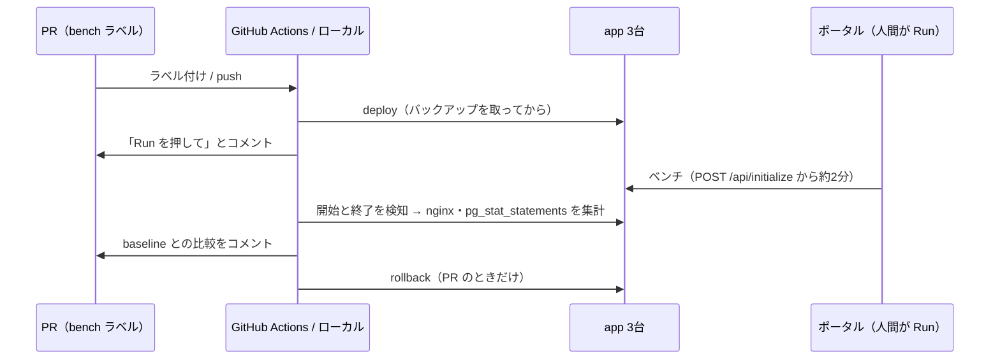

# bench — ベンチの計測と比較

ベンチはポータルからしか実行できず、チームで同時に 1 本だけ、最後の 1 本が最終スコア。
なので **実行（Run を押す）は人間**、それ以外（デプロイ・開始と終了の検知・集計・比較・後片付け）をこの道具がやる。



## 安全のための決まり
- **ログを消さない・`pg_stat_statements_reset` しない。** ログの位置と統計のスナップショットの差分で集計するので、他の人の計測（`measure.sh` など）を壊さない。
- **ベンチ中はデプロイしない。** asia1 の access.log が 5 秒で 20KB 以上伸びていたら中止。
- **手で入れた未コミットのコードを上書きしない。** サーバのソースのハッシュが、この道具で最後にデプロイしたものと違えば中止（#13）。初回は、サーバのコードが GitHub にコミット済みなのを確認してから `--force`。
- PR のベンチが終わったら、デプロイ前の状態に戻す（`~/.bench/backup`）。
- 同時実行はしない（Actions の `concurrency: bench`）。

## GitHub Actions（PR で使う）
1. app の変更を `Harineko0/isucon26` にブランチで push し、このリポジトリの PR で `app` サブモジュールをそのコミットに上げる。
2. PR に **`bench`** ラベルを付ける（以後の push でも毎回走る。外せば止まる）。
3. 「Run を押して」とコメントが来たら、15 分以内にポータルで Run。
4. 結果が PR にコメントされる（2xx 件数×倍率、リージョン別の平均/p99、エンドポイント別、DB の重いクエリ、baseline 比）。

baseline の更新: Actions → bench → Run workflow（main、`update_baseline` にチェック、分かれば `score`）。

必要な secrets:
| 名前 | 中身 |
|---|---|
| `BENCH_SSH_KEY` | 3 台に `isucon` で入れる SSH 秘密鍵（ベンチ専用の鍵を作って `authorized_keys` に足すのがおすすめ） |
| `SUBMODULE_TOKEN` | `Harineko0/isucon26` を読める fine-grained PAT（Contents: Read） |

## ローカルで使う
`~/.ssh/config` に `isucon26-asia` / `isucon26-europe` / `isucon26-america` があれば動く（Python 3.10+、標準ライブラリのみ）。

```sh
# 今のサーバのまま計測して baseline と比べる（Run は自分で押す）
python bench/bench.py run --label my-test --score 12345

# app/ をデプロイして計測し、終わったら元に戻す
python bench/bench.py run --deploy --rollback --label feature-x

# 個別に
python bench/bench.py snapshot -o snap.json
python bench/bench.py wait --snap snap.json
python bench/bench.py collect --snap snap.json -o result.json --label x
python bench/bench.py compare result.json --base bench/results/baseline.json
```

結果は `bench/results/<日時>-<label>.json` と `.md`。
